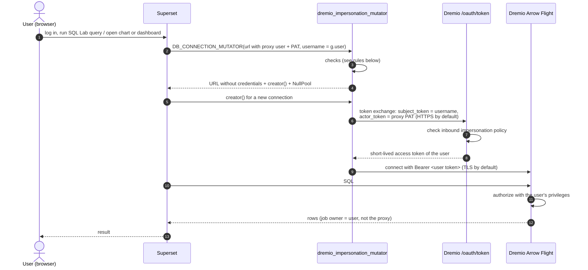
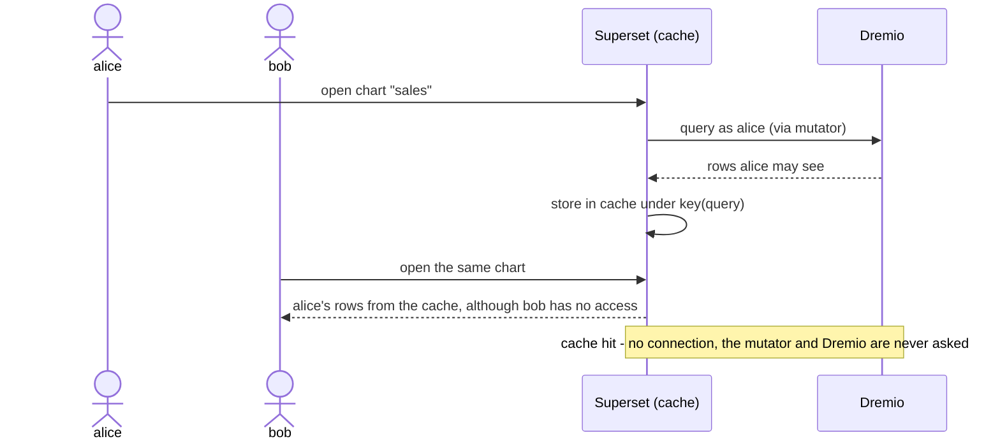
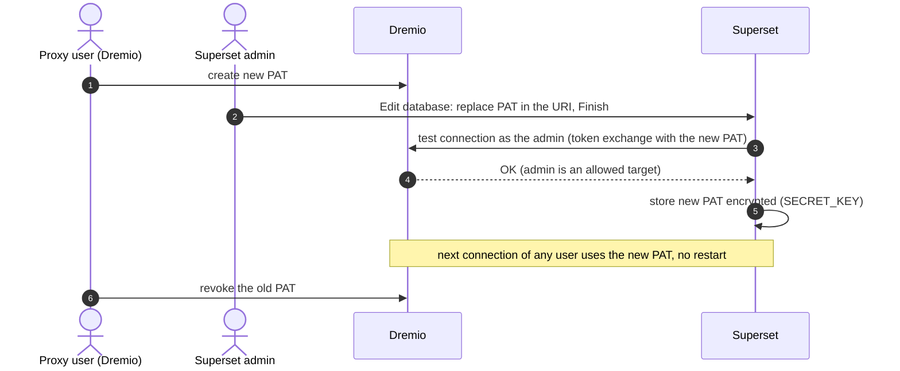

# Architecture

How the Dremio impersonation mutator for Apache Superset works and why it is
built this way. For installation and configuration, see [README.md](README.md);
for development and tests, see [CONTRIBUTING.md](CONTRIBUTING.md).

## Request flow



1. Superset calls the mutator for every engine it creates and passes the
   logged-in username (Superset's `get_username()`, i.e. `g.user`).
2. The mutator posts to `POST /oauth/token`
   ([docs](https://docs.dremio.com/current/reference/api/oauth-token/)):
   `grant_type=urn:ietf:params:oauth:grant-type:token-exchange`,
   `subject_token=<username>`, `subject_token_type=urn:ietf:params:oauth:token-type:dremio:subject`,
   `actor_token=<proxy PAT>`, `actor_token_type=urn:ietf:params:oauth:token-type:dremio:personal-access-token`,
   `scope=dremio.all`.
3. The Flight connection is created by a connection factory (`creator`) with
   that token. The token and the PAT are never put into the SQLAlchemy URL.
   `NullPool` is enforced, so connections are never shared between users.
   Every new connection does a fresh exchange (no token cache), so a rotated
   or revoked PAT takes effect at once.
4. Dremio checks the inbound impersonation policy and the user's privileges.

## Rules enforced by the mutator

- Only `dremio+flight` connections are changed; all other databases pass through.
- The URI must contain the proxy user and its PAT, and must not contain a
  static `Token` (it would bypass the impersonation).
- No logged-in user (CLI, anonymous/public access, background job without a
  user), embedded guest users, or a username equal to the proxy user (also the
  case when Superset's *Impersonate logged in user* is on): the query fails.
  **There is no fallback to the proxy user.** The error derives from
  Superset's `GenericDBException`.
- The PAT is sent only to the token endpoint, never to Flight.
- A URI parameter may repeat only with the same value (case-insensitive name);
  conflicting repeats are rejected, because they would make TLS settings
  ambiguous.
- `;` is rejected in parameter names, values and the database/schema name. The
  dialect joins its connection string with `;`, so `routing_queue=q;UseEncryption=false`
  would silently disable TLS, bypassing the mutator's checks and warnings.
- Any failure of the token request, including a rejected exchange (target not
  in the inbound policy; invalid, revoked or expired PAT) and a missing
  `TrustedCerts` file, becomes an `ImpersonationError`.
- Insecure TLS settings work, but are logged as `WARNING` once per process,
  host and problem (see [Transport security and logging](#transport-security-and-logging)).
- The issued token must be visible ASCII without `;` (the dialect's
  connection-string separator) and at most 16384 characters.
- Error and log messages contain no PAT, token, response body or connection
  string.

## Why connections are never pooled (`NullPool`)

The mutator always sets SQLAlchemy's `NullPool`: every query opens a new Flight
connection and closes it afterwards, instead of keeping it in a pool for reuse.
Every Flight connection carries the token of exactly one user, so pooling would
break the impersonation:

- **Wrong identity:** a pooled connection opened for alice could be handed to
  the next query on the same engine, which would then run as alice.
- **Revocation would be delayed:** a revoked PAT or a user removed from the
  inbound policy takes effect at the next token exchange; a pooled connection
  would keep the old token.
- **Expired tokens:** user tokens live at most one hour; a long-lived pooled
  connection would fail in the middle of a query.

With `NullPool`, every connection goes through the mutator's connection factory
and does a fresh token exchange for the logged-in user.

Superset already uses `NullPool` by default (in the tested version, all callers
use `get_sqla_engine(nullpool=True)`). The mutator enforces it anyway, so the
isolation does not depend on that default, on the dialect's own default
(`SingletonThreadPool`, one persistent connection per thread), or on pool
settings in the database's *Engine Parameters*; conflicting pool settings are
removed (see [Configuration](README.md#configuration)).

The cost is one new Flight connection and one HTTPS request to `/oauth/token`
per query; a dashboard with many charts causes as many token exchanges. There
is no token cache, by design.

## Why per-user cache keys are required

Superset caches chart and dashboard results. By default the cache key is built
from the query only (SQL, dataset, filters, limit), not from the user, because
Superset assumes that everyone gets the same data through the same database
connection. With impersonation that is no longer true: the same query returns
different data for different users.

The mutator cannot prevent this. It runs only when a connection is opened, and
a cache hit opens no connection:



With per-user cache keys enabled (`CACHE_QUERY_BY_USER` or *Per user caching*,
see [README.md](README.md#required-per-user-cache-keys)), Superset adds the
username to every chart-data cache key (`impersonation_key` in
`superset/common/query_object.py`), so bob gets a cache miss, his query runs
as bob, and Dremio denies it.

Superset's built-in *Impersonate logged in user* option (together with the
`CACHE_IMPERSONATION` feature flag) would also make the cache key per user, but
it must stay off with this mutator (see [Configuration](README.md#configuration)).

## Why the proxy must be a regular user, not a service user

The proxy proves its identity in the token exchange with `actor_token`, and
Dremio accepts only one `actor_token_type` for that:
`urn:ietf:params:oauth:token-type:dremio:personal-access-token`
([OAuth token API](https://docs.dremio.com/current/reference/api/oauth-token/)).
Dremio service users authenticate with OAuth client credentials or an external
service principal (JWT), not with PATs
([authentication](https://docs.dremio.com/current/security/authentication/)),
and they cannot own a PAT. So the proxy must be a regular local or LDAP user
with its own PAT: a dedicated technical account without data privileges.

## Transport security and logging

The mutator does not enforce TLS. `UseEncryption`, `DisableCertificateVerification`
and `TrustedCerts` are standard `sqlalchemy-dremio` options, and unencrypted or
unverified connections are legitimate for local tests. Because
`UseEncryption=false`, `DisableCertificateVerification=true` or an `http://`
`TokenUrl` expose the long-lived proxy PAT, the mutator logs a `WARNING`
through the logger `dremio_impersonation` instead of accepting them silently:

```
WARNING:dremio_impersonation:Dremio impersonation for dremio:32010: TLS certificate verification is DISABLED (DisableCertificateVerification=true); the proxy PAT can be intercepted. Use only for local tests.
```

Rejected token exchanges (for example a revoked PAT or a target outside the
inbound policy) are logged as `WARNING` with the username and HTTP status.
Log messages never contain the PAT or tokens.

Insecure settings are logged once per process, Dremio host and problem,
because the mutator runs for every query; one line per query would flood the
log. The logger `dremio_impersonation` has no own handlers, so Superset's
logging configuration decides format and destination.

## PAT rotation flow



Superset tests the connection as the editing admin before it saves a database
in the UI. The Superset admin therefore must be an allowed impersonation target
in Dremio (without data privileges); as a side effect, an invalid PAT cannot be
saved in the UI.

## Background and async execution

- Jobs run by Superset under `override_user` (async SQL Lab, global async
  queries, reports, alerts, thumbnails) are impersonated as the user Superset
  sets: the submitting user, or the configured executor for reports and
  thumbnails. Recipients of a report see the data of the executor. The local
  test environment has no Celery worker, so these paths are not tested.
- Any context without a user (CLI, `superset db upgrade`, scripts) fails.

## Dependencies on library internals

The mutator relies on these internals of the
[tested versions](README.md#requirements-and-tested-versions); re-check them
before changing a version:

- `sqlalchemy-dremio`: the connection string is built with
  `DremioDialect_flight.create_connect_args`, which adds `UID=`/`PWD=` only
  for a URL with a username and copies only known query parameters, and
  connections are opened with `sqlalchemy_dremio.db.Connection` and its
  `Token=` property.
- SQLAlchemy: the URL without credentials is rebuilt with `URL.create()`
  (`URL.set()` ignores `None`).
- Superset: the positional `DB_CONNECTION_MUTATOR` call in
  `superset/models/core.py` and its `username` argument (`get_username()`).
- Dremio: the token exchange parameters (see [Request flow](#request-flow)).
